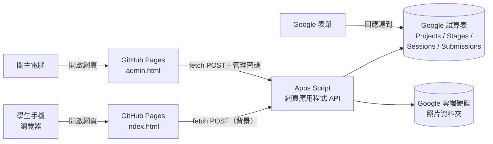
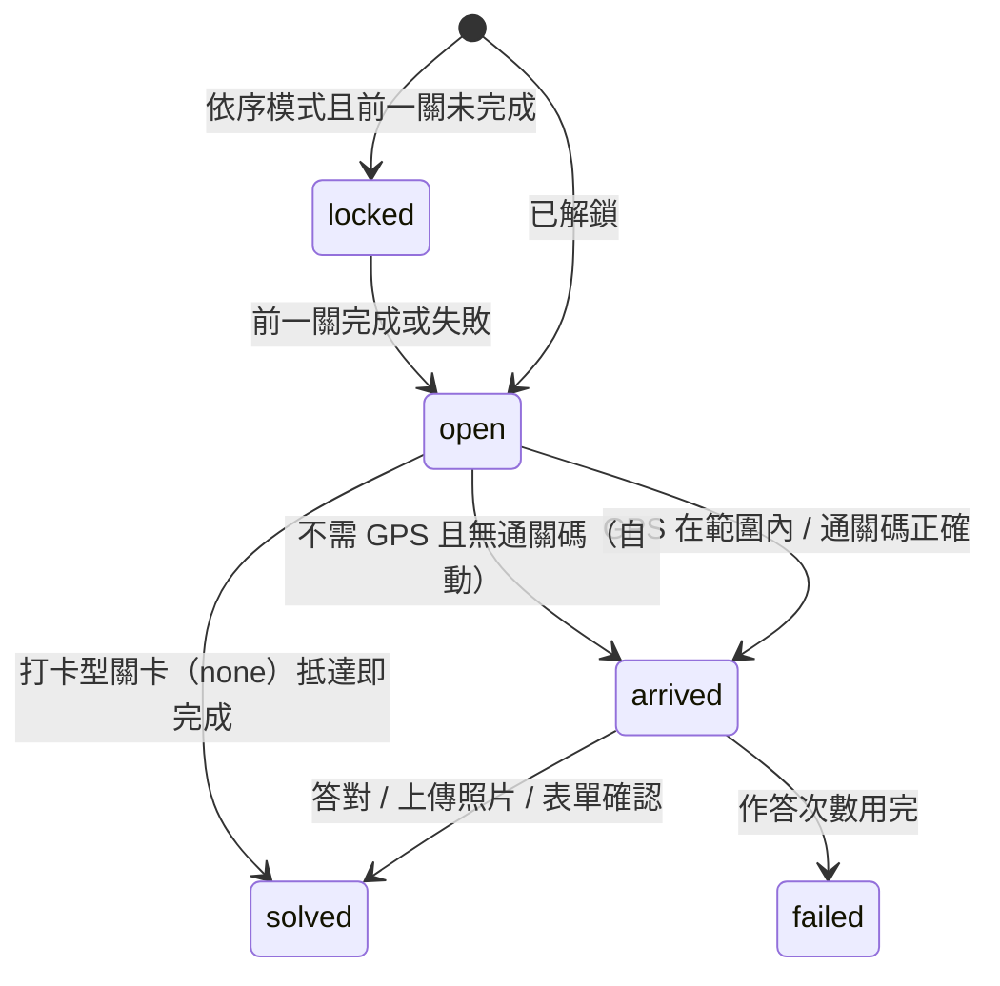
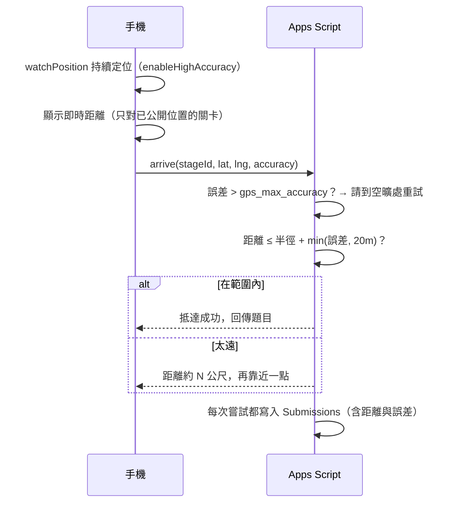

# GPS 實境解謎闖關系統｜設計文件

> 版本 1.0　｜　架構：GitHub Pages（前台＋後台頁面）＋ Google Apps Script（API）＋ Google 試算表（資料庫）

---

## 1. 目標與需求

| 需求 | 設計做法 |
|---|---|
| 關卡可以設定 GPS 定位，抵達後才能作答 | 每個關卡設定座標＋判定半徑，伺服器端計算距離，通過才把題目送到手機 |
| 有後台可以設定關卡 | `admin.html` 管理頁（地圖點選座標），也可以直接編輯試算表 |
| 前台可以看到關卡，不用登入 | 學生只開 GitHub Pages 網址，不經過任何 Google 登入頁 |
| 要記錄當次上傳的資訊 | 每一次打卡、作答、提示、照片都寫進試算表 `Submissions`，照片存 Google 雲端硬碟 |
| 可以連結 Google 試算表或表單 | 資料本身就在試算表；關卡可設為「Google 表單」類型，自動帶入隊伍代碼並可驗證是否送出 |
| 可以設計多個關卡專案、決定這次玩哪一個 | `Projects` 表管理多套路線，用網址 `?p=專案代碼` 指定，或設定首頁預設專案 |
| 活用在不同地點 | 「複製專案」後只改座標；用「場次代碼」區分同一路線的不同場次 |

---

## 2. 為什麼這樣架構

### 2.1 學生帳號無法進入的問題

如果整個網站都用 Apps Script 的網頁（`script.google.com/...`）呈現，常會遇到：

- 學校 Google Workspace 帳號被管理員限制，無法開啟外部網域的 Apps Script 網頁。
- 手機瀏覽器同時登入多個 Google 帳號時，Apps Script 網頁會出現錯誤或權限頁。
- 學校帳號部署時沒有「所有人」可以存取的選項。

### 2.2 解法：前後端分離



- 學生看到的是一般網址（`xxx.github.io`），**完全不會碰到 Google 登入**。
- Apps Script 只負責在背景收發 JSON，部署成「執行身分：我／存取：所有人」，用**個人 Gmail** 部署最保險。
- 前端以 `Content-Type: text/plain` 送 POST，避開瀏覽器的 CORS 預檢，Apps Script 不需另外設定。

### 2.3 公開程式碼的安全原則

GitHub 公開的 repo 誰都看得到，所以：

1. **答案、通關碼、管理密碼都不放在前端程式碼裡**，都放在試算表／Apps Script 指令碼屬性。
2. **題目內容在抵達之前不會送到手機**，打開開發者工具也看不到。
3. 所有判斷（距離、答案、解鎖順序、限時）都在伺服器端執行，前端只負責顯示。
4. 管理密碼存在 Script Properties，不在試算表儲存格裡；後台頁面雖然公開，但沒有密碼就無法讀寫。

---

## 3. 名詞定義

| 名詞 | 說明 |
|---|---|
| **專案 Project** | 一套完整的闖關路線，例如「A 校校園探索」「老街尋寶」。 |
| **關卡 Stage** | 專案裡的一個地點＋一個任務。 |
| **場次 Run** | 同一個專案在不同時間或班級舉辦時的標記，例如 `2026-11-25-AM`、`三年二班`。 |
| **隊伍／闖關紀錄 Session** | 一支隊伍玩一次專案的紀錄，不需要帳號，以隨機 UUID 識別。 |
| **隊伍代碼 Code** | 6 碼短代碼（例如 `KX7PQA`），給 Google 表單驗證、現場核對用。 |
| **作答紀錄 Submission** | 每一個動作的流水帳（開始、打卡、作答、提示、照片、表單）。 |

---

## 4. 功能規格

### 4.1 前台（index.html，學生用）

1. **選擇專案**：網址沒有 `?p=` 時，列出狀態為 `active` 的專案；只有一個時直接進入。
2. **開場介紹**：顯示專案封面、介紹、關卡數、限時等資訊。
3. **建立隊伍**：輸入隊伍名稱、成員（選填）、場次代碼（網址帶 `&run=` 時自動填入並隱藏）。
4. **關卡列表＋地圖**：顯示進度、分數、剩餘時間、自己的位置、已公開位置的關卡範圍圈，以及每關的方位與距離（例如「東北 230 公尺」）。
5. **關卡面板**：
   - 抵達前：線索、圖片、指南針（即時距離、方位、指向目標的箭頭）、「我到了，定位打卡」、現場通關碼輸入框、提示按鈕。
   - 抵達後：題目＋依作答方式顯示輸入介面。
   - 完成後：獲得分數、過關訊息。
6. **完成畫面**：總分、完成數、花費時間、完成訊息、排行榜（可關閉）。
7. **續玩**：隊伍編號存在手機 `localStorage`，重新整理或關掉瀏覽器再開都能接續；可按「換一支隊伍」重來。

### 4.2 後台（admin.html，關主用）

| 分頁 | 功能 |
|---|---|
| 專案 | 新增／編輯／複製／刪除專案；產生闖關連結與 QR Code（可帶場次代碼）；設定預設專案 |
| 關卡 | 關卡列表、上下移動調整順序、地圖總覽；編輯關卡時可在地圖點選、拖曳標記、貼上 Google 地圖座標、使用目前位置 |
| 闖關紀錄 | 依專案與場次篩選；隊伍進度、分數、目前關卡、最後活動時間；隊伍最後位置地圖；最新作答紀錄；每 20 秒自動更新 |

### 4.3 試算表本身就是後台

所有設定都可以直接改試算表。改完後：
- 手動編輯會自動觸發 `onEdit` 清除快取，前台約 30 秒內就會讀到新資料。
- 也可以按選單「🧩 實境解謎 → 套用修改（清除快取）」立即生效。

---

## 5. 資料表設計（Google 試算表）

執行選單「初始化」會自動建立以下四張工作表與欄位，並建立一個示範專案。可以在最右邊自行新增欄位（程式以表頭名稱對應，不受欄位順序影響）。

### 5.1 `Projects` 專案

| 欄位 | 型別 | 說明 |
|---|---|---|
| project_id | 文字 | 專案代碼，英數字、`-`、`_`，用於網址 `?p=` |
| name | 文字 | 專案名稱 |
| status | 選單 | `active` 開放並列在首頁／`hidden` 不列出但有連結可玩／`draft` 準備中／`closed` 已結束 |
| is_default | 勾選 | 首頁預設專案（只能一個） |
| unlock_mode | 選單 | `sequential` 依序解鎖／`free` 自由順序 |
| description | 文字 | 簡短說明 |
| intro | 長文字 | 開場介紹、規則 |
| finish_message | 長文字 | 全部完成後顯示的訊息 |
| cover_url | 網址 | 封面圖片 |
| start_at / end_at | 日期時間 | 開放與結束時間（可留空） |
| time_limit_min | 數字 | 限時分鐘，0 = 不限時，從隊伍按「開始」起算 |
| gps_max_accuracy | 數字 | 可接受的定位誤差上限（公尺），預設 80 |
| show_leaderboard | 勾選 | 完成後顯示排行榜 |
| require_run_code | 勾選 | 是否必須輸入場次代碼 |
| updated_at | 日期時間 | 系統自動 |

### 5.2 `Stages` 關卡

| 欄位 | 型別 | 說明 |
|---|---|---|
| project_id | 文字 | 所屬專案 |
| stage_id | 文字 | 關卡代碼（同專案內不重複） |
| order | 數字 | 順序 |
| enabled | 勾選 | 是否啟用 |
| title | 文字 | 關卡名稱 |
| clue | 長文字 | **抵達前**就看得到的線索 |
| image_url | 網址 | 線索圖片 |
| lat / lng | 數字 | 目標座標 |
| radius_m | 數字 | 判定半徑（公尺），預設 30，最小 5 |
| show_location | 勾選 | 在地圖上顯示位置；不勾則只靠線索找（仍會告訴距離，變成「冷熱遊戲」） |
| require_gps | 勾選 | 是否需要 GPS 打卡 |
| bypass_code | 文字 | 現場通關碼（備援，或室內關卡用） |
| question | 長文字 | **抵達後**才顯示的題目 |
| answer_type | 選單 | `text`／`number`／`choice`／`photo`／`form`／`none` |
| choices | 文字 | 選擇題選項，用 `\|` 分隔 |
| answer | 文字 | 正確答案，多個可接受答案用 `\|` 分隔；留空＝開放式作答 |
| points | 數字 | 分數，預設 10 |
| max_attempts | 數字 | 最多作答次數，0 = 不限 |
| hint1～hint3 | 文字 | 提示 |
| hint_penalty | 數字 | 每用一次提示扣幾分 |
| success_message | 文字 | 過關訊息（可寫下一站的線索） |
| form_url | 網址 | Google 表單預填連結，可用 `{code}` `{team}` `{run}` `{project}` |
| form_verify_sheet | 文字 | 表單回應工作表名稱，填了就會驗證是否真的有送出 |

### 5.3 `Sessions` 闖關紀錄（每隊一列）

| 欄位 | 說明 |
|---|---|
| session_id | UUID，存在學生手機，等同這支隊伍的「鑰匙」 |
| code | 6 碼隊伍代碼 |
| project_id / run_code | 專案與場次 |
| team_name / members | 隊名、成員 |
| status | `playing` 進行中／`finished` 完成／`timeup` 超時 |
| score | 目前分數 |
| started_at / last_active_at / finished_at | 時間 |
| last_lat / last_lng | 最後一次打卡時的位置（後台地圖用） |
| progress_json | 每關進度 JSON，例如 `{"s1":{"arrivedAt":"…","solvedAt":"…","attempts":2,"hints":1,"points":8}}` |
| user_agent | 裝置資訊（排除問題用） |

### 5.4 `Submissions` 作答紀錄（每個動作一列，只增不改）

| 欄位 | 說明 |
|---|---|
| timestamp | 時間 |
| session_id / code / project_id / run_code / team_name | 識別資訊 |
| stage_id / stage_title | 關卡 |
| action | `start` 開始／`arrive` 打卡／`answer` 作答／`hint` 提示／`photo` 照片／`form` 表單 |
| input | 學生輸入的內容（答案、通關碼、照片說明） |
| result | `ok`、`correct`、`wrong`、`failed`、`too_far`、`low_accuracy`、`wrong_code`、`uploaded`、`not_found` |
| points | 這次獲得的分數 |
| lat / lng / accuracy_m / distance_m | 打卡時的位置、誤差、與目標的距離 |
| file_url | 照片在雲端硬碟的連結 |
| note | 備註（打卡方式 gps/code、提示內容等） |

> 這張表就是「當次上傳資訊」的完整紀錄，可以直接用試算表篩選、樞紐分析、下載成 Excel。

---

## 6. 關卡規則

### 6.1 關卡狀態



| 狀態 | 前台顯示 | 看得到的內容 |
|---|---|---|
| locked 未解鎖 | 🔒 灰色 | 只有關卡名稱 |
| open 前往中 | 橘色 | 線索、圖片、位置（若公開）、距離 |
| arrived 作答中 | 藍色 | ＋題目、作答介面 |
| solved 已完成 | 綠色 ✓ | ＋過關訊息、得分 |
| failed 未通過 | 紅色 | 題目，0 分，但不擋住後面的關卡 |

### 6.2 作答方式

| answer_type | 前台介面 | 過關條件 |
|---|---|---|
| `text` 文字 | 輸入框 | 符合任一可接受答案（忽略大小寫、全半形、空白與標點） |
| `number` 數字 | 數字鍵盤 | 數值相等（`６`、`6.0` 都算 6） |
| `choice` 選擇題 | 選項按鈕 | 選到正確選項 |
| `photo` 拍照 | 開相機／選照片 | 上傳成功即過關（照片在手機端壓縮到長邊 1280px） |
| `form` Google 表單 | 開啟表單＋「我已送出」 | 有設驗證工作表時，必須在回應中找到隊伍代碼 |
| `none` 打卡 | 無 | 抵達即過關 |

> 文字題 `answer` 留空＝**開放式作答**（例如「寫下你的觀察」），任何內容都過關，內容會記錄在 Submissions。

### 6.3 計分

- 過關得分 = `points − 使用提示次數 × hint_penalty`（最低 0 分）。
- 作答次數用完 = 0 分。
- 排行榜排序：分數高 → 完成關卡多 → 花費時間短。

### 6.4 限時與開放時間

- `start_at` 之前、`end_at` 之後、狀態為 `draft`／`closed` 時，無法開始也無法作答。
- `time_limit_min` 從隊伍建立起算，時間到就把狀態改為 `timeup`，之後所有動作都會被拒絕，紀錄保留。

---

## 7. GPS 定位設計

### 7.1 判定流程



- 距離用 Haversine 公式計算。
- 依手機回報的誤差放寬判定範圍，但**最多只放寬 20 公尺**，避免誤差很大的定位直接通過。
- 打卡時優先使用 8 秒內、誤差 40 公尺以下的定位，否則重新取一次高精度定位。

### 7.2 距離與方向指引

關卡位置有公開（`show_location = TRUE`）時，關卡面板會顯示一個指南針：

| 項目 | 說明 |
|---|---|
| 距離 | 依手機定位即時更新；進入範圍內會變成綠色「已抵達！」 |
| 方位 | 「目標在你的東北方（41°）」，用方位角公式計算（0° = 北，90° = 東） |
| 箭頭 | 手機有指南針時，箭頭直接指向目標，並顯示「右前方、左後方…」等相對方向 |
| 沒有指南針 | 走路時改用 GPS 移動方向判斷；停下來時箭頭以「北」為上 |
| 關卡列表 | 每個前往中的關卡都會顯示「東北 230 公尺」 |

- iPhone 需要使用者點一下才能要求「動作與方向」權限：按「開始闖關」或第一次點開關卡時會詢問，也可以按面板裡的「🧭 啟用指南針」。
- Android 不需要另外允許。
- 位置隱藏的關卡（`show_location = FALSE`）不會顯示方向。按「我到了」時，系統只會告訴距離，變成冷熱遊戲。
- 使用指南針時，手機要盡量放平，而且要遠離磁鐵、喇叭或鐵製欄杆，否則方向會偏。

### 7.3 半徑建議

| 場地 | 建議半徑 |
|---|---|
| 空曠公園、操場 | 25–40 m |
| 一般校園、街道 | 40–60 m |
| 高樓旁、巷弄 | 60–100 m（GPS 會飄） |
| 室內 | 不要用 GPS，改用「現場通關碼」 |

### 7.4 備援：現場通關碼

- 每關可設定 `bypass_code`，貼在現場（紙條、QR、告示牌上的數字）。
- 用途：室內關卡、定位不準、學生手機不允許定位。
- `require_gps = FALSE` 且有 `bypass_code`：一定要輸入通關碼才能作答。
- `require_gps = TRUE` 且有 `bypass_code`：GPS 或通關碼擇一。

### 7.5 必要條件與限制

- 定位只能在 **HTTPS** 網頁使用 → GitHub Pages 預設就是 HTTPS。
- 學生第一次開始時瀏覽器會詢問定位權限，要按「允許」；iOS 需在「設定 → 隱私權 → 定位服務 → Safari」允許。
- GPS 可以被模擬軟體偽造，本系統定位為**教育／活動用途**，不做強防作弊；後台可看到每次打卡的距離與誤差，異常可人工判斷。

---

## 8. 不登入的身分紀錄

1. 按「開始闖關」→ 伺服器產生 `session_id`（UUID）與 6 碼 `code`，在 `Sessions` 新增一列。
2. 前端把 `session_id` 存在 `localStorage['gpsquest:專案代碼']`。
3. 之後每個 API 都帶 `session_id`，伺服器用它找到隊伍。
4. 同一台手機可以玩不同專案（各自獨立）；換人玩請按「換一支隊伍／重新開始」。
5. 一隊建議只用一支手機闖關，以免進度不同步（同隊多支手機會變成不同隊伍）。

---

## 9. 多專案與換地點的活用方式

### 9.1 決定這次玩哪一個專案

| 方式 | 說明 |
|---|---|
| 網址指定 | `index.html?p=school-a`（最推薦，QR Code 就是這個連結） |
| 首頁預設 | 專案勾選 `is_default`，學生打開首頁就排在第一個 |
| 只開放一個 | 只有一個 `active` 專案時，首頁直接進入 |
| 隱藏專案 | 狀態設 `hidden`：首頁看不到，但有連結的人可以玩（適合正式活動前測試、或只給特定班級） |

### 9.2 換一個地點

1. 後台「專案」→ 在原專案按「複製」→ 輸入新代碼與名稱。
2. 新專案預設為 `draft`，到「關卡」分頁逐一修改座標（地圖點選或貼上 Google 地圖座標）。
3. 視需要修改線索、題目。
4. 狀態改成 `hidden` 實地測試，沒問題再改 `active`。

### 9.3 同一路線舉辦多個場次

- 產生連結時填入場次代碼：`index.html?p=school-a&run=2026-11-25-AM`。
- 後台「闖關紀錄」與排行榜都可以依場次篩選，試算表也能用 `run_code` 篩選。
- 若勾選 `require_run_code`，學生沒有場次代碼就不能開始。

---

## 10. Google 表單整合

適合需要收集較多欄位的任務（問卷、心得、多題測驗）。

1. 建立 Google 表單，加入一題簡答「隊伍代碼」。
2. **表單設定：不要勾「限制只有 ○○ 網域的使用者」，也不要收集電子郵件。** 否則學生又會卡在登入。
3. 注意：Google 表單的「檔案上傳」題型**一定要登入**，所以拍照請用本系統的 `photo` 關卡。
4. 表單右上角 ⋮ →「取得預先填入的連結」→ 隊伍代碼欄填 `CODE` → 取得連結，例如：
   `https://docs.google.com/forms/d/e/xxxx/viewform?usp=pp_url&entry.123456=CODE`
5. 把 `CODE` 改成 `{code}`，貼到關卡的 `form_url`。
6. （選用驗證）表單「回覆 → 連結至試算表 → 選擇現有試算表」選這份試算表，會產生「表單回應 1」工作表，把這個名稱填到 `form_verify_sheet`。學生按「我已送出表單」時，系統會在該工作表搜尋隊伍代碼，找到才過關。

---

## 11. API 規格

- 端點：Apps Script 網頁應用程式網址（`…/exec`）
- 方法：`POST`，`Content-Type: text/plain;charset=utf-8`，內容為 JSON `{ "action": "...", ...參數 }`
- 回應：`{ "ok": true, ... }` 或 `{ "ok": false, "error": "中文錯誤訊息", "code": "錯誤代碼" }`

### 11.1 前台 API

| action | 參數 | 回傳 |
|---|---|---|
| `listProjects` | — | `projects[]` |
| `getProject` | `projectId` | `project` |
| `startSession` | `projectId, teamName, members?, runCode?, userAgent?` | `state` |
| `getSession` | `sessionId` | `state` |
| `arrive` | `sessionId, stageId, lat, lng, accuracy` 或 `code` | `state, arrived, distance_m?, message` |
| `submitAnswer` | `sessionId, stageId, answer` | `state, correct, message` |
| `getHint` | `sessionId, stageId` | `state, hint` |
| `uploadPhoto` | `sessionId, stageId, dataUrl, caption?` | `state, message` |
| `checkForm` | `sessionId, stageId` | `state, correct, message` |
| `leaderboard` | `projectId, runCode?` | `leaderboard[]` |

`state` 結構：

```json
{
  "session": { "session_id": "…", "code": "KX7PQA", "team_name": "第三小隊", "run_code": "",
               "status": "playing", "score": 18, "started_at": "…", "deadline": "…" },
  "project": { "project_id": "demo", "name": "…", "unlock_mode": "sequential", "show_leaderboard": true },
  "stages": [
    { "stage_id": "s1", "title": "第一站", "status": "solved", "answer_type": "number",
      "points": 10, "earned": 8, "clue": "…", "lat": 25.03, "lng": 121.53, "radius_m": 40,
      "question": "…", "hints": ["…"], "hints_total": 1 }
  ],
  "summary": { "total": 3, "solved": 1, "done": 1 },
  "finish_message": "",
  "just_finished": false
}
```

> `question`、`choices`、`form_url` 只有在 `arrived / solved / failed` 時才會出現；`answer`、`bypass_code` **永遠不會**送到前台。

### 11.2 後台 API（都要帶 `adminKey`）

| action | 參數 |
|---|---|
| `adminLogin` | — |
| `adminListProjects` | — |
| `adminGetProject` | `projectId` |
| `adminSaveProject` | `project, isNew` |
| `adminDeleteProject` | `projectId` |
| `adminDuplicateProject` | `projectId, newId, newName` |
| `adminSaveStage` | `stage, isNew` |
| `adminDeleteStage` | `projectId, stageId` |
| `adminReorderStages` | `projectId, order[]` |
| `adminSessions` | `projectId, runCode?` |
| `adminSubmissions` | `projectId, runCode?, limit?` |
| `adminDeleteSession` | `sessionId` |

### 11.3 錯誤代碼

| code | 意義 |
|---|---|
| `SESSION_NOT_FOUND` | 找不到隊伍（前台會自動回到建立隊伍畫面） |
| `NOT_FOUND` / `NOT_OPEN` / `CLOSED` | 專案不存在、尚未開放、已結束 |
| `LOCKED` / `NOT_ARRIVED` | 關卡未解鎖、尚未抵達 |
| `WRONG_CODE` / `NEED_CODE` / `NO_GPS` | 通關碼錯誤、需要通關碼、沒有定位資料 |
| `TIMEUP` / `FINISHED` | 時間到、已完成 |
| `UNAUTHORIZED` | 管理密碼錯誤 |
| `BUSY` | 同時人數過多，請重試 |

---

## 12. 效能與容量

- **快取**：專案與關卡設定快取 30 秒（CacheService），每次後台儲存或手動編輯試算表都會讓快取失效。
- **鎖定**：所有寫入動作使用 `LockService` 依序處理，避免同時寫入造成資料錯亂。
- **容量估計**：Apps Script 一次請求約 0.5–1.5 秒；一般 20–40 隊同時進行沒有問題。超過 100 隊同時進行可能偶爾出現「目前人數較多，請再按一次」。
- **配額**：個人 Gmail 每日網頁應用程式執行時間與觸發次數對一般活動綽綽有餘；若一年辦很多大型活動，可考慮 Google Workspace 帳號或改用 Firebase。
- **照片**：手機端壓縮到約 200–400 KB；存在雲端硬碟「GPS實境解謎_上傳照片 / 專案代碼」資料夾，預設只有你看得到。

---

## 13. 活動前檢查清單

- [ ] `config.js` 已填入 Apps Script 網址，前台能看到專案。
- [ ] Apps Script 部署為「執行身分：我／存取：所有人」，修改程式後有「管理部署作業 → 編輯 → 新版本」。
- [ ] 每個關卡的座標都實地走過一次（狀態設 `hidden` 測試）。
- [ ] 用**學生的手機與學校網路**實際測試（防火牆、管理型 Chromebook 可能擋外部網站）。
- [ ] iPhone 與 Android 各測一次定位權限流程。
- [ ] 室內或高樓旁的關卡有設定現場通關碼。
- [ ] Google 表單沒有限制網域、沒有收集電子郵件。
- [ ] 印好 QR Code（後台「連結／QR」，可帶場次代碼）。
- [ ] 準備關主手機開著後台「闖關紀錄」監看。
- [ ] 正式開始前把測試隊伍刪除，或用不同場次代碼區分。

---

## 14. 擴充方向

| 想法 | 做法 |
|---|---|
| 照片人工審核才給分 | `photo` 關卡過關改成 `pending`，後台加「通過／退回」按鈕 |
| 關卡到達順序隨機（分流） | 每隊依 `code` 產生不同的關卡順序，避免全部擠在同一站 |
| 時間獎勵 | 依完成時間加分，在 `solve_` 計算 |
| 多語系 | 關卡欄位加 `title_en` 等，前台依語言切換 |
| 大型活動 | 後端改 Firebase（Firestore＋Cloud Functions），前台程式只需改 `api()` 函式 |
| 離線容錯 | Service Worker 快取前台頁面，網路恢復後重送 |

---

## 15. 檔案結構

```
gps-quest/
├── index.html          前台（學生闖關）
├── admin.html          後台（關主管理）
├── config.js           ★ 貼上 Apps Script 網址
├── css/style.css       共用樣式
├── js/common.js        API 呼叫、工具函式
├── js/player.js        前台邏輯（定位、地圖、作答）
├── js/admin.js         後台邏輯（專案、關卡、監看）
├── apps-script/
│   ├── Code.gs         ★ 貼到試算表的 Apps Script
│   └── appsscript.json 專案設定（時區 Asia/Taipei）
├── DESIGN.md           本文件
└── README.md           部署步驟
```
