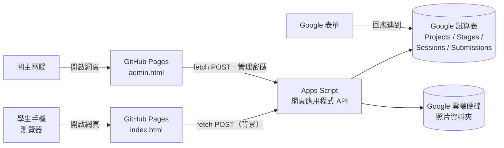
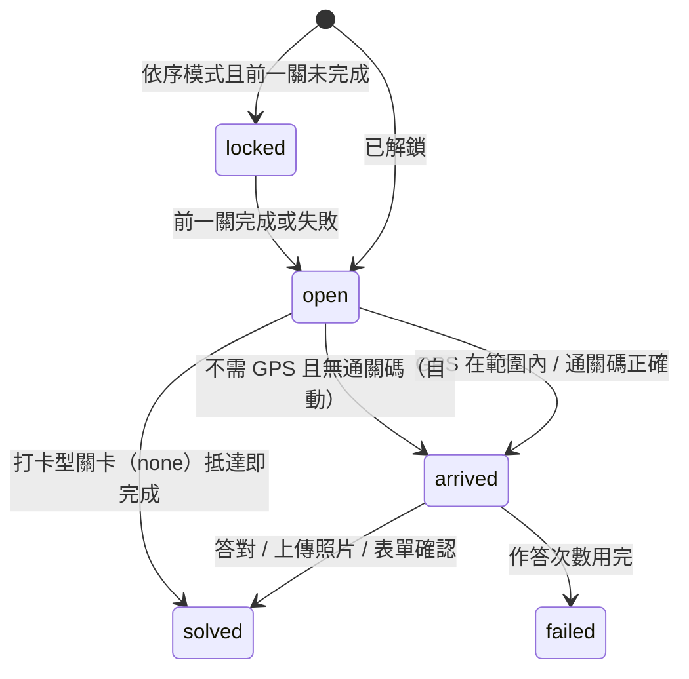
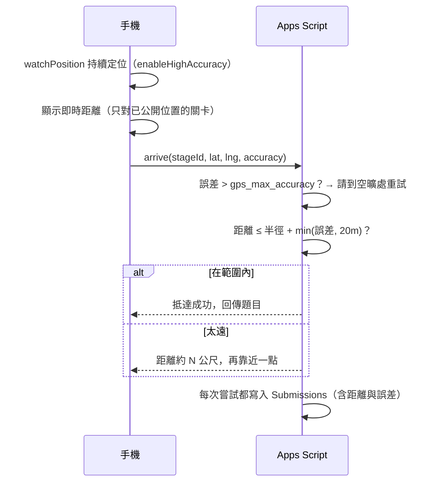

# 實境解謎｜設計文件

> 版本 1.0　｜　架構：GitHub Pages（前台＋後台頁面）＋ Google Apps Script（API）＋ Google 試算表（資料庫）

---

## 1. 目標與需求

| 需求 | 設計做法 |
|---|---|
| 關卡可以設定 GPS 定位，抵達後才能作答 | 每個關卡設定座標＋判定半徑，伺服器端計算距離，通過才把題目送到手機 |
| 有後台可以設定關卡 | `admin.html` 管理頁（地圖點選座標），也可以直接編輯試算表 |
| 前台可以看到關卡，不用登入 | 學生只開 GitHub Pages 網址，不經過任何 Google 登入頁 |
| 要記錄當次上傳的資訊 | 每一次打卡、作答、提示、照片都寫進試算表 `Submissions`，照片存 Google 雲端硬碟 |
| 可以連結 Google 試算表或表單 | 資料本身就在試算表；關卡可設為「Google 表單」類型，自動帶入隊伍代碼並可驗證是否送出 |
| 可以設計多個關卡專案、決定這次玩哪一個 | `Projects` 表管理多套路線，用網址 `?p=專案代碼` 指定，或設定首頁預設專案 |
| 活用在不同地點 | 「複製專案」後只改座標；用「場次代碼」區分同一路線的不同場次 |

---

## 2. 為什麼這樣架構

### 2.1 學生帳號無法進入的問題

如果整個網站都用 Apps Script 的網頁（`script.google.com/...`）呈現，常會遇到：

- 學校 Google Workspace 帳號被管理員限制，無法開啟外部網域的 Apps Script 網頁。
- 手機瀏覽器同時登入多個 Google 帳號時，Apps Script 網頁會出現錯誤或權限頁。
- 學校帳號部署時沒有「所有人」可以存取的選項。

### 2.2 解法：前後端分離



- 學生看到的是一般網址（`xxx.github.io`），**完全不會碰到 Google 登入**。
- Apps Script 只負責在背景收發 JSON，部署成「執行身分：我／存取：所有人」，用**個人 Gmail** 部署最保險。
- 前端以 `Content-Type: text/plain` 送 POST，避開瀏覽器的 CORS 預檢，Apps Script 不需另外設定。

### 2.3 公開程式碼的安全原則

GitHub 公開的 repo 誰都看得到，所以：

1. **答案、通關碼、管理密碼都不放在前端程式碼裡**，都放在試算表／Apps Script 指令碼屬性。
2. **題目內容在抵達之前不會送到手機**，打開開發者工具也看不到。
3. 所有判斷（距離、答案、解鎖順序、限時）都在伺服器端執行，前端只負責顯示。
4. 管理密碼存在 Script Properties，不在試算表儲存格裡；後台頁面雖然公開，但沒有密碼就無法讀寫。

---

## 3. 名詞定義

| 名詞 | 說明 |
|---|---|
| **專案 Project** | 一套完整的闖關路線，例如「A 校校園探索」「老街尋寶」。 |
| **關卡 Stage** | 專案裡的一個地點＋一個任務。 |
| **場次 Run** | 同一個專案在不同時間或班級舉辦時的標記，例如 `2026-11-25-AM`、`三年二班`。 |
| **隊伍／闖關紀錄 Session** | 一支隊伍玩一次專案的紀錄，不需要帳號，以隨機 UUID 識別。 |
| **隊伍代碼 Code** | 6 碼短代碼（例如 `KX7PQA`），給 Google 表單驗證、現場核對用。 |
| **作答紀錄 Submission** | 每一個動作的流水帳（開始、打卡、作答、提示、照片、表單）。 |

---

## 4. 功能規格

### 4.1 前台（index.html，學生用）

1. **選擇專案**：網址沒有 `?p=` 時，列出狀態為 `active` 的專案；只有一個時直接進入。
2. **開場介紹**：顯示專案封面、介紹、關卡數、限時等資訊。
3. **建立隊伍**：輸入隊伍名稱、場次代碼（網址帶 `&run=` 時自動填入並隱藏）。
4. **關卡列表＋地圖**：顯示進度、分數、剩餘時間、自己的位置、已公開位置的關卡範圍圈，以及每關的方位與距離（例如「東北 230 公尺」）。
5. **關卡面板**：
   - 抵達前：線索、圖片、指南針（即時距離、方位、指向目標的箭頭）、「我到了，定位打卡」、現場通關碼輸入框、提示按鈕。
   - 抵達後：題目＋依作答方式顯示輸入介面。
   - 完成後：獲得分數、過關訊息。
6. **完成畫面**：總分、完成數、花費時間、完成訊息、排行榜（可關閉）。
7. **續玩**：隊伍編號存在手機 `localStorage`，重新整理或關掉瀏覽器再開都能接續；可按「換一支隊伍」重來。

### 4.2 後台（admin.html，關主用）

| 分頁 | 功能 |
|---|---|
| 專案 | 新增／編輯／複製／刪除專案；產生闖關連結與 QR Code（可帶場次代碼）；設定預設專案 |
| 關卡 | 關卡列表、上下移動調整順序、地圖總覽；編輯關卡時可在地圖點選、拖曳標記、貼上 Google 地圖座標、使用目前位置 |
| 闖關紀錄 | 依專案與場次篩選；隊伍進度、分數、目前關卡、最後活動時間；隊伍最後位置地圖；最新作答紀錄；每 20 秒自動更新 |

### 4.3 試算表本身就是後台

所有設定都可以直接改試算表。改完後：
- 手動編輯會自動觸發 `onEdit` 清除快取，前台約 30 秒內就會讀到新資料。
- 也可以按選單「🧩 實境解謎 → 套用修改（清除快取）」立即生效。

---

## 5. 資料表設計（Google 試算表）

執行選單「初始化」會自動建立以下四張工作表與欄位，並建立一個示範專案。可以在最右邊自行新增欄位（程式以表頭名稱對應，不受欄位順序影響）。

### 5.1 `Projects` 專案

| 欄位 | 型別 | 說明 |
|---|---|---|
| project_id | 文字 | 專案代碼，英數字、`-`、`_`，用於網址 `?p=` |
| name | 文字 | 專案名稱 |
| status | 選單 | `active` 開放並列在首頁／`hidden` 不列出但有連結可玩／`draft` 準備中／`closed` 已結束 |
| is_default | 勾選 | 首頁預設專案（只能一個） |
| unlock_mode | 選單 | `sequential` 依序解鎖／`free` 自由順序 |
| description | 文字 | 簡短說明 |
| intro | 長文字 | 開場介紹、規則 |
| finish_message | 長文字 | 全部完成後顯示的訊息 |
| cover_url | 網址 | 封面圖片 |
| start_at / end_at | 日期時間 | 開放與結束時間（可留空） |
| time_limit_min | 數字 | 限時分鐘，0 = 不限時，從隊伍按「開始」起算 |
| gps_max_accuracy | 數字 | 可接受的定位誤差上限（公尺），預設 80 |
| show_leaderboard | 勾選 | 完成後顯示排行榜 |
| require_run_code | 勾選 | 是否必須輸入場次代碼 |
| updated_at | 日期時間 | 系統自動 |

### 5.2 `Stages` 關卡

| 欄位 | 型別 | 說明 |
|---|---|---|
| project_id | 文字 | 所屬專案 |
| stage_id | 文字 | 關卡代碼（同專案內不重複） |
| order | 數字 | 順序 |
| enabled | 勾選 | 是否啟用 |
| title | 文字 | 關卡名稱 |
| clue | 長文字 | **抵達前**就看得到的線索 |
| image_url | 網址 | 線索圖片 |
| lat / lng | 數字 | 目標座標 |
| radius_m | 數字 | 判定半徑（公尺），預設 30，最小 5 |
| show_location | 勾選 | 在地圖上顯示位置；不勾則只靠線索找（仍會告訴距離，變成「冷熱遊戲」） |
| require_gps | 勾選 | 是否需要 GPS 打卡 |
| bypass_code | 文字 | 現場通關碼（備援，或室內關卡用） |
| question | 長文字 | **抵達後**才顯示的題目 |
| answer_type | 選單 | `text`／`number`／`choice`／`photo`／`form`／`none` |
| choices | 文字 | 選擇題選項，用 `\|` 分隔 |
| answer | 文字 | 正確答案，多個可接受答案用 `\|` 分隔；留空＝開放式作答 |
| points | 數字 | 分數，預設 10 |
| max_attempts | 數字 | 最多作答次數，0 = 不限 |
| hint1～hint3 | 文字 | 提示 |
| hint_penalty | 數字 | 每用一次提示扣幾分 |
| success_message | 文字 | 過關訊息（可寫下一站的線索） |
| form_url | 網址 | Google 表單預填連結，可用 `{code}` `{team}` `{run}` `{project}` |
| form_verify_sheet | 文字 | 表單回應工作表名稱，填了就會驗證是否真的有送出 |

### 5.3 `Sessions` 闖關紀錄（每隊一列）

| 欄位 | 說明 |
|---|---|
| session_id | UUID，存在學生手機，等同這支隊伍的「鑰匙」 |
| code | 6 碼隊伍代碼 |
| project_id / run_code | 專案與場次 |
| team_name | 隊名 |
| status | `playing` 進行中／`finished` 完成／`timeup` 超時 |
| score | 目前分數 |
| started_at / last_active_at / finished_at | 時間 |
| last_lat / last_lng | 最後一次打卡時的位置（後台地圖用） |
| progress_json | 每關進度 JSON，例如 `{"s1":{"arrivedAt":"…","solvedAt":"…","attempts":2,"hints":1,"points":8}}` |
| user_agent | 裝置資訊（排除問題用） |

### 5.4 `Submissions` 作答紀錄（每個動作一列，只增不改）

| 欄位 | 說明 |
|---|---|
| timestamp | 時間 |
| session_id / code / project_id / run_code / team_name | 識別資訊 |
| stage_id / stage_title | 關卡 |
| action | `start` 開始／`arrive` 打卡／`answer` 作答／`hint` 提示／`photo` 照片／`form` 表單 |
| input | 學生輸入的內容（答案、通關碼、照片說明） |
| result | `ok`、`correct`、`wrong`、`failed`、`too_far`、`low_accuracy`、`wrong_code`、`uploaded`、`not_found` |
| points | 這次獲得的分數 |
| lat / lng / accuracy_m / distance_m | 打卡時的位置、誤差、與目標的距離 |
| file_url | 照片在雲端硬碟的連結 |
| note | 備註（打卡方式 gps/code、提示內容等） |

> 這張表就是「當次上傳資訊」的完整紀錄，可以直接用試算表篩選、樞紐分析、下載成 Excel。

---

## 6. 關卡規則

### 6.1 關卡狀態



| 狀態 | 前台顯示 | 看得到的內容 |
|---|---|---|
| locked 未解鎖 | 🔒 灰色 | 只有關卡名稱 |
| open 前往中 | 橘色 | 線索、圖片、位置（若公開）、距離 |
| arrived 作答中 | 藍色 | ＋題目、作答介面 |
| solved 已完成 | 綠色 ✓ | ＋過關訊息、得分 |
| failed 未通過 | 紅色 | 題目，0 分，但不擋住後面的關卡 |

### 6.2 作答方式

| answer_type | 前台介面 | 過關條件 |
|---|---|---|
| `text` 文字 | 輸入框 | 符合任一可接受答案（忽略大小寫、全半形、空白與標點） |
| `number` 數字 | 數字鍵盤 | 數值相等（`６`、`6.0` 都算 6） |
| `choice` 選擇題 | 選項按鈕 | 選到正確選項 |
| `photo` 拍照 | 開相機／選照片 | 上傳成功即過關（照片在手機端壓縮到長邊 1280px） |
| `form` Google 表單 | 開啟表單＋「我已送出」 | 有設驗證工作表時，必須在回應中找到隊伍代碼 |
| `none` 打卡 | 無 | 抵達即過關 |

> 文字題 `answer` 留空＝**開放式作答**（例如「寫下你的觀察」），任何內容都過關，內容會記錄在 Submissions。

### 6.3 計分

- 過關得分 = `points − 使用提示次數 × hint_penalty`（最低 0 分）。
- 作答次數用完 = 0 分。
- 排行榜排序：分數高 → 完成關卡多 → 花費時間短。

### 6.4 限時與開放時間

- `start_at` 之前、`end_at` 之後、狀態為 `draft`／`closed` 時，無法開始也無法作答。
- `time_limit_min` 從隊伍建立起算，時間到就把狀態改為 `timeup`，之後所有動作都會被拒絕，紀錄保留。

---

## 7. GPS 定位設計

### 7.1 判定流程



- 距離用 Haversine 公式計算。
- 依手機回報的誤差放寬判定範圍，但**最多只放寬 20 公尺**，避免誤差很大的定位直接通過。
- 打卡時優先使用 8 秒內、誤差 40 公尺以下的定位，否則重新取一次高精度定位。

### 7.2 距離與方向指引

關卡位置有公開（`show_location = TRUE`）時，關卡面板會顯示一個指南針：

| 項目 | 說明 |
|---|---|
| 距離 | 依手機定位即時更新；進入範圍內會變成綠色「已抵達！」 |
| 方位 | 「目標在你的東北方（41°）」，用方位角公式計算（0° = 北，90° = 東） |
| 箭頭 | 手機有指南針時，箭頭直接指向目標，並顯示「右前方、左後方…」等相對方向 |
| 沒有指南針 | 走路時改用 GPS 移動方向判斷；停下來時箭頭以「北」為上 |
| 關卡列表 | 每個前往中的關卡都會顯示「東北 230 公尺」 |

- iPhone 需要使用者點一下才能要求「動作與方向」權限：按「開始闖關」或第一次點開關卡時會詢問，也可以按面板裡的「🧭 啟用指南針」。
- Android 不需要另外允許。
- 位置隱藏的關卡（`show_location = FALSE`）不會顯示方向。按「我到了」時，系統只會告訴距離，變成冷熱遊戲。
- 使用指南針時，手機要盡量放平，而且要遠離磁鐵、喇叭或鐵製欄杆，否則方向會偏。

### 7.3 半徑建議

| 場地 | 建議半徑 |
|---|---|
| 空曠公園、操場 | 25–40 m |
| 一般校園、街道 | 40–60 m |
| 高樓旁、巷弄 | 60–100 m（GPS 會飄） |
| 室內 | 不要用 GPS，改用「現場通關碼」 |

### 7.4 備援：現場通關碼

- 每關可設定 `bypass_code`，貼在現場（紙條、QR、告示牌上的數字）。
- 用途：室內關卡、定位不準、學生手機不允許定位。
- `require_gps = FALSE` 且有 `bypass_code`：一定要輸入通關碼才能作答。
- `require_gps = TRUE` 且有 `bypass_code`：GPS 或通關碼擇一。

### 7.5 必要條件與限制

- 定位只能在 **HTTPS** 網頁使用 → GitHub Pages 預設就是 HTTPS。
- 學生第一次開始時瀏覽器會詢問定位權限，要按「允許」；iOS 需在「設定 → 隱私權 → 定位服務 → Safari」允許。
- GPS 可以被模擬軟體偽造，本系統定位為**教育／活動用途**，不做強防作弊；後台可看到每次打卡的距離與誤差，異常可人工判斷。

---

## 8. 不登入的身分紀錄

1. 按「開始闖關」→ 伺服器產生 `session_id`（UUID）與 6 碼 `code`，在 `Sessions` 新增一列。
2. 前端把 `session_id` 存在 `localStorage['escapegame:專案代碼']`。
3. 之後每個 API 都帶 `session_id`，伺服器用它找到隊伍。
4. 同一台手機可以玩不同專案（各自獨立）；換人玩請按「換一支隊伍／重新開始」。
5. 一隊建議只用一支手機闖關，以免進度不同步（同隊多支手機會變成不同隊伍）。

---

## 9. 多專案與換地點的活用方式

### 9.1 決定這次玩哪一個專案

| 方式 | 說明 |
|---|---|
| 網址指定 | `index.html?p=school-a`（最推薦，QR Code 就是這個連結） |
| 首頁預設 | 專案勾選 `is_default`，學生打開首頁就排在第一個 |
| 只開放一個 | 只有一個 `active` 專案時，首頁直接進入 |
| 隱藏專案 | 狀態設 `hidden`：首頁看不到，但有連結的人可以玩（適合正式活動前測試、或只給特定班級） |

### 9.2 換一個地點

1. 後台「專案」→ 在原專案按「複製」→ 輸入新代碼與名稱。
2. 新專案預設為 `draft`，到「關卡」分頁逐一修改座標（地圖點選或貼上 Google 地圖座標）。
3. 視需要修改線索、題目。
4. 狀態改成 `hidden` 實地測試，沒問題再改 `active`。

### 9.3 同一路線舉辦多個場次

- 產生連結時填入場次代碼：`index.html?p=school-a&run=2026-11-25-AM`。
- 後台「闖關紀錄」與排行榜都可以依場次篩選，試算表也能用 `run_code` 篩選。
- 若勾選 `require_run_code`，學生沒有場次代碼就不能開始。

---

## 10. Google 表單整合

適合需要收集較多欄位的任務（問卷、心得、多題測驗）。

1. 建立 Google 表單，加入一題簡答「隊伍代碼」。
2. **表單設定：不要勾「限制只有 ○○ 網域的使用者」，也不要收集電子郵件。** 否則學生又會卡在登入。
3. 注意：Google 表單的「檔案上傳」題型**一定要登入**，所以拍照請用本系統的 `photo` 關卡。
4. 表單右上角 ⋮ →「取得預先填入的連結」→ 隊伍代碼欄填 `CODE` → 取得連結，例如：
   `https://docs.google.com/forms/d/e/xxxx/viewform?usp=pp_url&entry.123456=CODE`
5. 把 `CODE` 改成 `{code}`，貼到關卡的 `form_url`。
6. （選用驗證）表單「回覆 → 連結至試算表 → 選擇現有試算表」選這份試算表，會產生「表單回應 1」工作表，把這個名稱填到 `form_verify_sheet`。學生按「我已送出表單」時，系統會在該工作表搜尋隊伍代碼，找到才過關。

---

## 11. API 規格

- 端點：Apps Script 網頁應用程式網址（`…/exec`）
- 方法：`POST`，`Content-Type: text/plain;charset=utf-8`，內容為 JSON `{ "action": "...", ...參數 }`
- 回應：`{ "ok": true, ... }` 或 `{ "ok": false, "error": "中文錯誤訊息", "code": "錯誤代碼" }`

### 11.1 前台 API

| action | 參數 | 回傳 |
|---|---|---|
| `listProjects` | — | `projects[]` |
| `getProject` | `projectId` | `project` |
| `startSession` | `projectId, teamName, runCode?, userAgent?` | `state` |
| `getSession` | `sessionId` | `state` |
| `arrive` | `sessionId, stageId, lat, lng, accuracy` 或 `code` | `state, arrived, distance_m?, message` |
| `submitAnswer` | `sessionId, stageId, answer` | `state, correct, message` |
| `getHint` | `sessionId, stageId` | `state, hint` |
| `uploadPhoto` | `sessionId, stageId, dataUrl, caption?` | `state, message` |
| `checkForm` | `sessionId, stageId` | `state, correct, message` |
| `leaderboard` | `projectId, runCode?` | `leaderboard[]` |

`state` 結構：

```json
{
  "session": { "session_id": "…", "code": "KX7PQA", "team_name": "第三小隊", "run_code": "",
               "status": "playing", "score": 18, "started_at": "…", "deadline": "…" },
  "project": { "project_id": "demo", "name": "…", "unlock_mode": "sequential", "show_leaderboard": true },
  "stages": [
    { "stage_id": "s1", "title": "第一站", "status": "solved", "answer_type": "number",
      "points": 10, "earned": 8, "clue": "…", "lat": 25.03, "lng": 121.53, "radius_m": 40,
      "question": "…", "hints": ["…"], "hints_total": 1 }
  ],
  "summary": { "total": 3, "solved": 1, "done": 1 },
  "finish_message": "",
  "just_finished": false
}
```

> `question`、`choices`、`form_url` 只有在 `arrived / solved / failed` 時才會出現；`answer`、`bypass_code` **永遠不會**送到前台。

### 11.2 後台 API（都要帶 `adminKey`）

| action | 參數 |
|---|---|
| `adminLogin` | — |
| `adminListProjects` | — |
| `adminGetProject` | `projectId` |
| `adminSaveProject` | `project, isNew` |
| `adminDeleteProject` | `projectId` |
| `adminDuplicateProject` | `projectId, newId, newName` |
| `adminUploadImage` | `projectId, kind(cover\|stage), dataUrl` → `{ url, file_id }`（存到 Drive `<專案>/_images`，連結可檢視） |
| `adminSaveStage` | `stage, isNew` |
| `adminDeleteStage` | `projectId, stageId` |
| `adminReorderStages` | `projectId, order[]` |
| `adminSessions` | `projectId, runCode?` |
| `adminSubmissions` | `projectId, runCode?, limit?` |
| `adminDeleteSession` | `sessionId` |

### 11.3 錯誤代碼

| code | 意義 |
|---|---|
| `SESSION_NOT_FOUND` | 找不到隊伍（前台會自動回到建立隊伍畫面） |
| `NOT_FOUND` / `NOT_OPEN` / `CLOSED` | 專案不存在、尚未開放、已結束 |
| `LOCKED` / `NOT_ARRIVED` | 關卡未解鎖、尚未抵達 |
| `WRONG_CODE` / `NEED_CODE` / `NO_GPS` | 通關碼錯誤、需要通關碼、沒有定位資料 |
| `TIMEUP` / `FINISHED` | 時間到、已完成 |
| `UNAUTHORIZED` | 管理密碼錯誤 |
| `BUSY` | 同時人數過多，請重試 |

---

## 12. 效能與容量

- **快取**：專案與關卡設定快取 30 秒（CacheService），每次後台儲存或手動編輯試算表都會讓快取失效。
- **鎖定**：所有寫入動作使用 `LockService` 依序處理，避免同時寫入造成資料錯亂。
- **容量估計**：Apps Script 一次請求約 0.5–1.5 秒；一般 20–40 隊同時進行沒有問題。超過 100 隊同時進行可能偶爾出現「目前人數較多，請再按一次」。
- **配額**：個人 Gmail 每日網頁應用程式執行時間與觸發次數對一般活動綽綽有餘；若一年辦很多大型活動，可考慮 Google Workspace 帳號或改用 Firebase。
- **照片**：手機端壓縮到約 200–400 KB；存在雲端硬碟「實境解謎_上傳照片 / 專案代碼」資料夾，預設只有你看得到。

---

## 13. 活動前檢查清單

- [ ] GitHub 的 Repository variable `APPS_SCRIPT_URL` 已設定、Pages 來源是 GitHub Actions，部署成功後前台能看到專案。
- [ ] Apps Script 部署為「執行身分：我／存取：所有人」，修改程式後有「管理部署作業 → 編輯 → 新版本」。
- [ ] 每個關卡的座標都實地走過一次（狀態設 `hidden` 測試）。
- [ ] 用**學生的手機與學校網路**實際測試（防火牆、管理型 Chromebook 可能擋外部網站）。
- [ ] iPhone 與 Android 各測一次定位權限流程。
- [ ] 室內或高樓旁的關卡有設定現場通關碼。
- [ ] Google 表單沒有限制網域、沒有收集電子郵件。
- [ ] 印好 QR Code（後台「連結／QR」，可帶場次代碼）。
- [ ] 準備關主手機開著後台「闖關紀錄」監看。
- [ ] 正式開始前把測試隊伍刪除，或用不同場次代碼區分。

---

## 14. 擴充方向

| 想法 | 做法 |
|---|---|
| 照片人工審核才給分 | `photo` 關卡過關改成 `pending`，後台加「通過／退回」按鈕 |
| 關卡到達順序隨機（分流） | 每隊依 `code` 產生不同的關卡順序，避免全部擠在同一站 |
| 時間獎勵 | 依完成時間加分，在 `solve_` 計算 |
| 多語系 | 關卡欄位加 `title_en` 等，前台依語言切換 |
| 大型活動 | 後端改 Firebase（Firestore＋Cloud Functions），前台程式只需改 `api()` 函式 |
| 離線容錯 | Service Worker 快取前台頁面，網路恢復後重送 |

---

## 15. 檔案結構

```
EscapeGame/
├── index.html            前台（學生闖關）
├── admin.html            後台（關主管理）
├── board.html            大螢幕即時排行榜
├── config.example.js     本機測試範本（複製成 config.js；正式上線由 GitHub Actions 產生）
├── css/style.css         共用樣式與主題
├── js/
│   ├── common.js         API 呼叫、版本檢查、共用工具
│   ├── player.js         前台邏輯（定位、地圖、作答、圖鑑）
│   ├── admin.js          後台邏輯（專案、關卡、圖鑑、監看）
│   └── board.js          大螢幕排行榜
├── vendor/               Leaflet、QR Code 函式庫的本地副本
├── apps-script/
│   ├── Code.gs           ★ 貼到試算表的 Apps Script
│   └── appsscript.json   專案設定（時區 Asia/Taipei）
├── tools/loadtest.js     活動前負載演練腳本
├── .github/              GitHub Actions 部署（deploy.yml）與產生 config.js 的腳本
├── DESIGN.md             本文件
└── README.md             部署與使用說明
```


## 路線與隊伍名單（同一專案、不同隊伍走不同關卡）

- Projects 新增欄位：`routes`（JSON：`[{id, name, color}]`，`id` 是系統隨機產生的 4–20 碼代碼）、`teams`（JSON：`[{name, route}]`）。
- Stages 新增 `routes`：`"代碼|代碼:順序"`；空白＝所有路線共用；冒號後的數字是該路線內的順序。
- Sessions／Submissions 新增 `route`。
- 有 `teams`：玩家只能從名單選隊伍，路線由名單決定（網址上的 `route` 不採用）；同場次同隊伍名稱再次開始＝接續原進度。
- 沒有 `teams` 但有 `routes`：用網址 `route`（專屬 QR Code）；沒帶就平均分配到人數最少的路線；代碼不存在回 `BAD_ROUTE`。
- 前台 API 不回傳路線代碼：`getProject` 只回隊伍名單與路線名稱（`link_info`），闖關中的 `state.project.routes` 只含自己的路線。
- 新增 API：`adminSetRoute`（`sessionId, route`）更換某隊路線；`leaderboard` 可帶 `route` 篩選，回傳 `route_name`。
- 連結參數：`?p=專案&run=場次&team=隊伍名稱&route=路線代碼`。

## 排行榜與各隊進度

- 專案設定 `leaderboard_live`（即時排行榜）：開啟後，闖關頁頂部出現「🏆 排行榜」，並可用 `board.html?p=專案代碼[&run=場次]` 在大螢幕顯示（每 15 秒自動更新）。
- `leaderboard` API：`board:true` 需要 `leaderboard_live`；一般（完成頁）需要 `show_leaderboard`。回傳每隊的分數、完成關數／總關數、狀態、已用時間、最近活動時間、路線名稱與顏色；不回傳路線代碼，也不透露目前關卡名稱或位置。

## 密碼碎片（連動解謎）

- Stages 新增：`reward_code`（過關給的碎片）、`reward_order`（在最終密碼裡排第幾碼）、`final_from_fragments`（最後一關：答案＝本路線所有碎片依 `reward_order` 接起來，忽略 `answer`）。
- 只有「過關」的關卡給碎片；作答次數用完（未通過）不給。沒取得的碎片內容不會傳到前台，標準答案也不會傳到前台。
- 最後一關沒集齊碎片 → `submitAnswer` 回 `NEED_FRAGMENTS`（不計作答次數）。
- 多路線：碎片依該隊路線內的關卡計算，各路線各自組成自己的最終密碼。
- `state.fragments`：`[{order, stage_id, stage_title, stage_no, got, code}]`；最後一關帶 `uses_fragments`、`fragments_missing`。
- `adminResetFailed`（`sessionId`）：把這隊未通過的關卡還原成可重新挑戰，補救缺碎片而卡關的隊伍。

## 防亂猜與排行榜開放時間

- 專案設定 `wrong_lock_after`（連續答錯幾次後暫停，預設 3，0＝不限制）與 `wrong_lock_sec`（暫停秒數，預設 30，每鎖定一次加倍，最久 600 秒）。答案與「現場通關碼」都適用；冷卻中連正確答案也不能送，且不計作答次數。`publicStage_` 帶 `wait_sec`，前台顯示倒數。
- 排行榜（即時／完成頁）只在專案的 `start_at`～`end_at` 期間回傳資料；未開始回 `NOT_OPEN`、已結束回 `CLOSED`；沒設定時間＝不限制。
- 最後一關（`final_from_fragments`）沒集齊碎片時，後端不接受作答，前台連答案欄都不顯示。

## 收藏冊、隊伍造型、成就徽章、合作任務

- Stages 新增：`item_name`、`item_icon`（emoji 或圖片網址）、`item_rarity`（normal／rare／legend）、`item_story`；`coop_final`（合作最後關）。Projects 新增 `collect_message`；Sessions 新增 `avatar`；隊伍名單 `teams[].avatar`（可指定造型）。
- 收藏冊：過關才算收集。`state.collection`：沒收集到的只回傳圖示（前台顯示剪影），名稱與故事不外洩；過關當下 `stages[].item` 帶完整收藏品資料。
- 隨行夥伴（前台）：每收集一個收藏品，地圖上自己的造型標記後方多一個夥伴，排在移動方向的反側。
- 隊伍造型：玩家建立隊伍時從 16 個 emoji 選一個（名單指定的優先、不可改）；顯示在地圖、頂部列、排行榜、後台紀錄。
- 成就徽章與稱號：由進度即時算出，不另外儲存（初試啼聲、一擊必中、不靠提示、越挫越勇、收藏家、全收集、合作達人、完賽、閃電隊）；稱號依徽章數量：0–1 新手、2–3 熟練、4–5 傳奇、6 以上探險大師。`state.badges`、`state.title`；排行榜每列也帶造型、稱號與徽章。
- 合作任務：`coop_final` 的答案＝專案內每條路線各自的碎片字串，依路線順序接起來。前台只告知每條路線有幾個碎片，不給別條路線的內容；玩家必須和其他路線的隊伍交換密碼。自己的碎片沒集齊時不能作答。專案少於 2 條路線時，當作一般最後一關。

## 圖鑑本（卡牌製作）

- 圖鑑本是獨立資源（Decks 工作表：`deck_id, title, kind, style, cards`），專案用 `deck_id` 決定使用哪一本；可以做很多本，不同專案可用不同的本，或不使用。
- `kind`：`nature`（荒野自然名角色：屬性、HP、攻擊、防禦、技能）、`place`（在地景點／代表物：人氣、歷史、美景）、`custom`。
- `style`（卡面畫風）：`foil` 閃卡（稀有、傳說會閃光）、`classic` 古典標本、`watercolor` 水彩、`pixel` 像素。
- 後台「圖鑑本」頁：貼上多筆名稱（換行、逗號、頓號分隔）就依名稱自動產生屬性、稀有度、數值、技能、故事（同名同結果，可重新隨機）；可逐張修改、換成 emoji 或上傳的圖、調整順序。
- 關卡設定：`card_id`（固定給一張）、`card_random`（再隨機抽 N 張，依稀有度 70／25／5，不重複，不會抽到其他關卡固定給的卡）。過關時抽卡並記在隊伍進度，後台關卡列表會顯示「最多可給幾張，是否能全收集」。
- 前台：`state.collection` 在有圖鑑時就是整本圖鑑；沒拿到的卡只給編號、屬性、稀有度與圖（剪影），名稱與數值不外洩。過關有開卡翻面動畫；🎒 內可看整本、點卡片放大傾斜看閃光。

## 體驗調整：教學、活動前檢查

- 新手教學：第一次進入闖關畫面顯示 2–5 張教學（依專案有沒有收藏／碎片／即時排行榜調整內容），可跳過，`localStorage` 記住。
- 抵達打卡成功：全螢幕「📍 抵達！」動畫加震動；🎒 有新收集（卡牌、徽章、碎片）時顯示紅點，開啟後圖鑑中新卡標示 NEW；背包圖鑑上方有收集進度條。
- 已完成／未通過的關卡面板只留結果，線索與題目收合。
- 離線時頂部顯示「📴 離線中」；答案、說明、通關碼輸入會即時暫存到 `localStorage`（斷線、重新整理後還在，答對後清除）。
- 大字模式（頂部 `Aa`）：整體文字放大 18%，設定會記住。
- 試玩：後台**已沒有「🧪 試玩」按鈕**（從後台跳到前台後，在主畫面圖示開啟的後台回不來）。活動前請用「連結／QR」的連結實際玩一遍，測完到「闖關紀錄」刪除測試隊伍。後端的試玩金鑰機制（Script Properties `TEST_TOKEN`、`adminGetTestToken`）保留給 `tools/loadtest.js` 負載演練使用，試玩隊伍不計入排行榜、專案隊伍數、路線平均分配；「闖關紀錄」仍標示 🧪，並可一鍵清除試玩隊伍與作答紀錄（`adminClearTests`）。前台網址不再處理 `test=1`、`tt=` 參數。
- 活動前檢查（`adminCheckProject`）：回傳 error／warn／info 清單，包含缺座標、範圍太小、選擇題沒選項、缺答案、碎片順序重複、有碎片但作答次數有限、路線沒有關卡、圖鑑無法全收集、結束時間早於開放時間等，並可「前往」該項設定。

## 圖鑑：用名稱搜尋圖片

- 後台圖鑑編輯器：每張卡有 🔍「找圖」，用名稱搜尋「維基共享資源」（Wikimedia Commons，只收可自由使用的授權；排除 fair use / non-free，圖寬至少 300px）。中文名稱結果太少時，會用中文維基百科找出對應的英文條目名稱補充搜尋。
- 「🖼 自動找圖」：為還沒有圖片（只有 emoji）的卡牌依序找第一張合適的圖（約每張 0.7 秒）；結果不一定符合，需逐張檢查。
- 選用的圖會記錄 `art_credit`（作者／授權／來源），顯示在後台與玩家的卡片檢視裡；手動改圖或換成 emoji 會清除授權文字。
- `adminImportImage`：把圖片（只允許 `https://upload.wikimedia.org/`）下載存到雲端硬碟（`decks/_images`），回傳雲端硬碟網址，活動當天不依賴外部網站。需要 Apps Script 的外部連線權限（`UrlFetchApp`），部署後第一次執行要重新授權。

## 穩定性與資料安全

- 試算表文字欄位（關卡的線索、題目、答案、碎片、提示、路線，隊伍的 user_agent 等）一律設成「純文字」，新增欄位時也立刻套用，避免 `007` 變 `7`、`1-2` 變日期、`=` 開頭被當成公式。數字欄位一律設成數字格式，被誤讀成日期（Date）時會轉回原本的序列值。
- 隊伍名稱與 user_agent 會去掉開頭的 `= + - @`（防止試算表公式注入）。
- 前台 API：30 秒沒回應視為連線失敗；後端回 `BUSY`（很多人同時操作排隊太久）時自動重試最多 3 次。
- 圖鑑每本各自快取（避免超過快取 100KB）；儲存圖鑑超過 4.5 萬字（試算表一格上限 5 萬字）會明確拒絕。後台作答紀錄只讀最後 3000 列。
- `resumeSession`：用隊伍代碼接續進度（換手機、清除瀏覽器資料後）；隊伍代碼在同一專案內不重複。
- Leaflet 與 QRCode 函式庫放在 `vendor/`，不依賴外部 CDN。

## 卡面圖片顯示

- 卡牌欄位 `art_fit`：`contain`（完整顯示，預設，空白處用同一張圖放大模糊填滿）或 `cover`（填滿裁切）；`art_pos`：`center`／`top`／`bottom`（填滿裁切時的對焦位置）。舊的卡牌沒有這兩個欄位時，一律視為「完整顯示」。


---

## 手機操作優化

### 玩家端
- **關卡面板**：指南針與距離下方有「只顯示我與這一關目標」的小地圖（沒有定位的關卡不顯示；離開面板會銷毀）。手機單指不拖曳地圖（避免擋住捲動），用雙指縮放或「我與目標」「只看目標」按鈕。首頁地圖手機上點一下進全螢幕。
- **沒有任何定位關卡的專案**：不顯示地圖、定位標籤與地圖按鈕，不持續定位；定位權限仍在進入時詢問一次。有定位關卡則進入就要求並持續定位。
- **放大卡片**：右上角 ✕、關閉鈕固定在底部、點旁邊空白處或在卡片外往下滑可關閉。翻牌動畫不依賴 `backface-visibility`（iPhone Safari 會讓卡背透出來），改在翻到一半時切換顯示。
- **定位提示**：定位失敗時顯示依 iPhone／Android 區分的設定步驟與「重新定位」按鈕。離目標超過 600 公尺時自動改用低精度定位（省電），進入 350 公尺內切回高精度；任務結束（通關、時間到、關閉）後停止定位與指南針。
- **防呆**：送出中不能連點；只剩最後一次作答機會時先確認；照片上傳顯示進度並可重新選擇。
- **離線暫存**：斷線時「打卡」「送答案」（不含照片）先存在手機（`localStorage`，`escapegame:queue:<隊伍>`），狀態標籤顯示「待送出 N」；恢復連線或每 15 秒自動補送。補送時這關若已完成或回傳錯誤就丟棄、超過 6 小時的不補送，避免重複。補送的錯誤答案仍會消耗作答次數。
- **限時提醒**：有時間限制的專案，剩 10 分鐘、3 分鐘各提醒一次（橫幅＋震動＋提示音，重新整理不重複）。
- **打卡回饋**：整個畫面先閃一層綠色，再跳出「抵達！」。
- **隊伍代碼**：遊戲首頁常駐一行並有「複製」鈕。
- **成果圖**：通關畫面「📸 存成圖片／分享」以 canvas 畫出隊名、稱號、分數、時間、成就與卡牌（只畫 emoji 與名稱；上傳的圖片因跨網域會讓 canvas 無法匯出，所以不畫）；支援長按存圖、下載與系統分享（iOS 15 以上）。
- **加到主畫面**：`manifest.webmanifest` 與 `icons/`；狀態列用不透明黑色（`black-translucent` 會讓標題被時間蓋住）。沒有 service worker，改版時不會讓玩家看到舊版。已加入的圖示要刪除重加才會套用新設定。

### 後台
- **版面**：手機寬度（760px 以下）分頁列移到畫面底部；編輯視窗整頁顯示，儲存列固定在底部、刪除按鈕移到最下方「危險區」；關卡與圖鑑編輯依小標題分段收合；隊伍表與關卡表改成卡片。
- **現場**：登入後預設分頁。每隊一張卡（進度條、目前關卡、幾分鐘前有動作、📍 看位置開 Google 地圖、🔄 還原未通過），超過 10 分鐘沒動作的隊伍排最前面並標紅，每 20 秒自動更新。
- **作答紀錄**：手機用卡片（電腦仍是表格）；可選一隊查看「每一關做到哪裡」（完成、已打卡、答錯幾次、看提示幾次），並可篩「只看答錯／異常」「有照片」。一次讀最近 300 筆，進度是依紀錄推算，完整紀錄在試算表 `Submissions`。
- **圖鑑卡編輯**：「上一張／下一張」固定在編輯區頂端，切換前會先存下目前這張的修改。手機上在卡片預覽或欄位空白處**左右滑動**也能換張（需明顯的橫向滑動；輸入欄位、按鈕上不觸發，不影響上下捲動）。
- **貼 Google 地圖網址轉座標**：關卡「地點」可貼座標、完整網址（優先讀標記位置 `!3d!4d`，其次 `?q=`、`?ll=`、`place/`、`@` 畫面中心）或手機「分享」的短網址。短網址由後端 `adminResolveMapUrl` 展開（只允許明確列出的 Google 網域，轉址最多 6 次，不得轉到非 Google 網址）；展開失敗時提示改貼完整網址或座標。
- **記住這台裝置**：登入頁勾選後，管理密碼以**明文**存在該手機的 `localStorage` 30 天（從主畫面圖示開啟時預設勾選）。只適合自己的手機；登出或後端回報密碼錯誤時會清除；手機遺失請重設管理密碼。
- **從主畫面圖示開啟後台**：跳到前台或排行榜頁面時，左下角有「← 回後台」（用 `sessionStorage` 標記，只有從這個後台跳過去才會出現）。

### 版面自動檢查
`tools/mobilecheck.js` 以 headless Chrome 用 320、360、390、412 寬檢查橫向捲動、超出畫面、太小的按鈕與被裁掉的卡片，可存截圖：

```bash
python -m http.server 8000                        # 先在專案資料夾啟動
node tools/mobilecheck.js                         # 檢查 index.html、admin.html、board.html
node tools/mobilecheck.js --shots out/ <網址>…    # 指定網址並存截圖
```
需要登入或後端資料的頁面，請用模擬資料的測試頁檢查（腳本也接受 `file://` 網址）。

### 真機驗收清單（每次改版或活動前）
iPhone（Safari）與 Android（Chrome）各一支，用現場會用的瀏覽器，從開始玩到通關：
1. **定位**：第一次按「開始闖關」跳出權限；拒絕後依提示開啟，再按「重新定位」。
2. **聲音與震動**：右上角 🔊 開啟後，抵達、答對、答錯、通關各有聲音（iPhone 不支援網頁震動、靜音鍵會影響）。
3. **關卡**：小地圖有自己與目標；打卡、答題、看提示（扣分確認）、拍照上傳。
4. **卡牌**：過關翻牌動畫沒有卡背透出；背包與完成畫面點卡片放大，往下滑或點空白處可關閉。
5. **離線**：開飛航模式後送答案，標籤顯示「待送出」；關閉飛航模式後自動補送。
6. **通關**：成果圖可長按存圖或分享；定位已停止。
7. **加到主畫面**：前台、後台各加一次，標題沒有被時間蓋住；後台記住密碼；從後台跳到前台能「← 回後台」。
8. **後台**：底部分頁列、儲存列固定、卡片式隊伍表與作答紀錄、貼地圖網址轉座標。

## 營運與維運說明

### 日常使用

| 我想… | 怎麼做 |
|---|---|
| 換一個地點辦活動 | 後台「專案」→「複製」→ 到「關卡」改座標 |
| 決定這次玩哪個專案 | 給學生 `index.html?p=專案代碼` 的連結或 QR Code；或把專案設為「預設」 |
| 同一路線辦好幾場 | 產生連結時填「場次代碼」，紀錄會自動分開 |
| 看各隊進度、答題紀錄 | 後台「闖關紀錄」，或直接看試算表 `Sessions`、`Submissions`；照片在雲端硬碟「實境解謎_上傳照片」 |
| 大螢幕顯示排行榜 | `board.html?p=專案代碼`（專案需開啟「即時排行榜」） |
| 直接改試算表 | 可以！改完約 30 秒內生效，或按選單「套用修改」 |
| 忘記管理密碼 | 試算表選單「🧩 實境解謎 → 顯示管理密碼」 |
| 換管理密碼 | 試算表選單「重設管理密碼」 |

#### 防呆與自動備份

- **版本提醒**：後端版本過舊時，後台頂端會提示重新部署 `Code.gs`；前台過舊時，會提示重新整理。
- **活動進行中守門**：有隊伍正在闖關（6 小時內有操作）時，刪除或重排關卡、修改路線與隊伍名單、把專案改回準備中或已結束，都要輸入專案代碼才能繼續。刪除整個專案一律要輸入專案代碼。
- **開放前把關**：專案改成「開放中」時會自動做活動前檢查；有嚴重錯誤（沒有關卡、座標缺失或不合理、隊伍或路線名稱重複…）會退回「準備中」並列出原因。
- **輸入檢查**：緯度、經度超出範圍直接擋下；座標離其他關卡超過 20 公里、抵達範圍小於 15 公尺會先確認。
- **自動備份**：刪除專案、關卡、隊伍、圖鑑或清除試玩資料之前，會先把相關工作表複製成隱藏的「備份_時間_原因_表名」分頁（同一張表 10 分鐘內只備份一次，最多保留 24 張，超過 2 萬列的表不備份）。要找回：試算表選單「檢視 → 隱藏的工作表」顯示出來，再把資料複製回原本的工作表。

#### 活動前負載演練

很多隊伍同時作答時，寫入會排隊。正式活動前可以先跑一次演練（需要 Node 18 以上）：

```bash
node tools/loadtest.js <API_URL> <管理密碼> <專案代碼> [隊伍數=30] [秒數=30]
```

- 全部使用「試玩隊伍」，不進排行榜，結束後自動清除（清除前會自動備份）。
- 列出成功率、排隊逾時（BUSY）次數與回應時間的中位數、p95。腳本不會自動重試，所以 BUSY 比真實玩家遇到的更多。
- 專案若設了「預設隊伍名單」，試玩隊伍會被擋，請用沒有名單的測試專案。請在沒有正式活動時跑，避免連續跑很多次（會消耗每日額度）。
- 想知道哪個動作慢：瀏覽器按 F12 → Console，會看到 `[api] 動作：後端 xxx ms／整體 xxx ms`。

### 安全設計

- **前端沒有任何密碼。** 網頁只知道 Apps Script 的網址，網址本來就一定看得到。`config.js` 沒有提交到 git，由 GitHub Actions 部署時產生：別人 clone 或 fork 看不到你的網址，但線上網站仍看得到，這在靜態網站無法避免。
- 真正要保護的是後端：
  - 所有後台功能（`admin*`）都必須帶**管理密碼**，由後端驗證。密碼是 12 碼隨機字元，存在 Apps Script 的指令碼屬性，不在原始碼裡。
  - 猜密碼限制：15 分鐘內錯 10 次，後台鎖定 15 分鐘（期間連正確密碼也不收，到期自動解除）。
  - 猜隊伍代碼限制：同一專案 10 分鐘內錯 20 次，暫時不能用代碼接續進度。
  - 請求頻率限制：同一支隊伍每分鐘最多 60 次操作；同一專案每分鐘最多 300 次「開始闖關」。數字可在 `Code.gs` 的 `RATE` 調整。
  - 玩家端只能做遊戲需要的動作（開始、打卡、作答、傳照片），試玩模式需要後台給的金鑰。
- 限制：Apps Script 拿不到使用者的 IP，所以頻率限制是以隊伍、專案、後台為單位，不是以人為單位。
- **fork 或複製這個專案時，請設定自己的 `APPS_SCRIPT_URL`**（自己部署一份 Apps Script）。不要使用別人的網址，否則資料會寫進別人的試算表。
- 管理密碼外洩：試算表選單「重設管理密碼」。網址外洩想換掉：Apps Script 重新部署取得新網址，更新 `APPS_SCRIPT_URL` 後重新部署，並封存舊的部署作業。

### 常見問題

**網站顯示「這個網站還沒有設定後端網址」**
Repository variable `APPS_SCRIPT_URL` 沒設定，或設定後還沒重新部署（見「後端設定」第 5、6 步）。本機測試則是沒有 `config.js`。

**GitHub Actions 部署失敗（紅色叉叉）**
點進失敗的那次執行看訊息：「缺少 APPS_SCRIPT_URL」＝變數沒設；「格式不正確」＝網址要是 `https://script.google.com/macros/s/.../exec`，不要有引號或空白；其他錯誤多半是 Settings → Pages 的 Source 沒有選 GitHub Actions。

**前台顯示「伺服器回應格式錯誤」**
Apps Script 部署時「誰可以存取」不是「所有人」，或修改程式後沒有部署新版本。

**定位一直說太遠／誤差太大**
請學生到空曠處，手機開啟「精確位置」；後台可以把該關半徑放大，或調高專案的「可接受定位誤差」，或改用現場通關碼。

**iPhone 沒有跳出定位詢問**
設定 → 隱私權與安全性 → 定位服務 → Safari 網站 → 「使用 App 期間」，然後重新整理頁面。

**地圖沒有顯示**
地圖使用 OpenStreetMap，若網路擋住地圖圖磚，關卡功能仍可正常使用（距離與打卡不受影響）。

