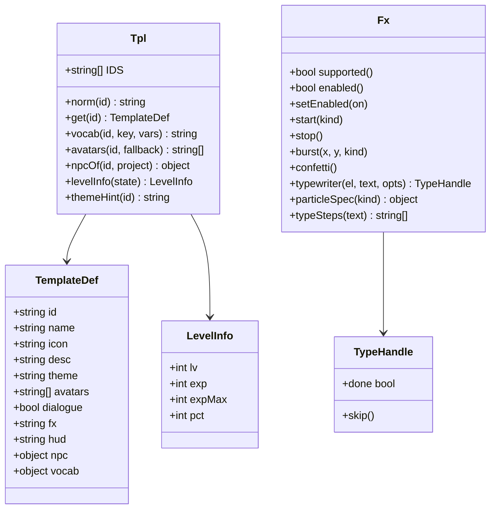
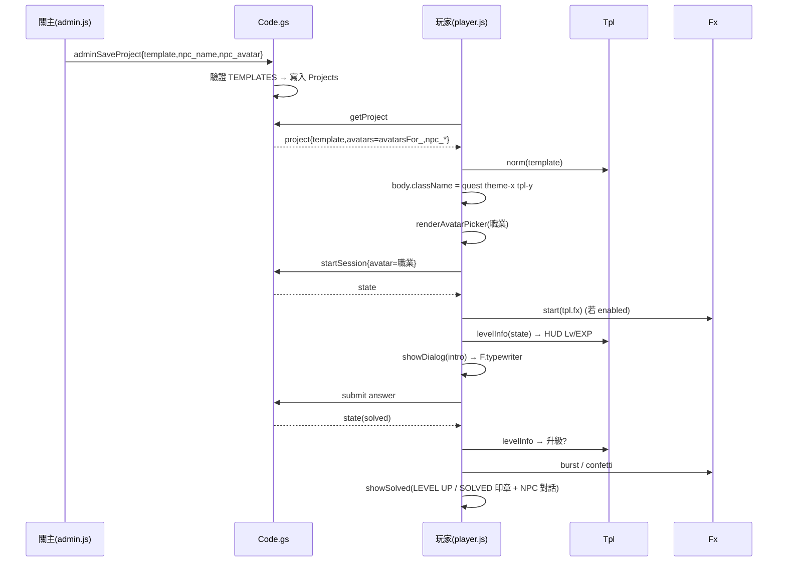

# 系統設計：體驗套版（Experience Template）

## 1. Implementation Approach
- **資料驅動、零相依**：新增 `js/templates.js`（套版註冊表＋純函式）、`js/fx.js`（特效＋逐字輸出）、`css/templates.css`（`body.tpl-*` 規則）。維持無建置、無新套件、無圖片素材（emoji＋CSS＋Canvas）。
- **正交於色彩主題**：`body` 同時帶 `theme-xxx`（顏色）與 `tpl-xxx`（用語／版型／特效）。`templates.css` 只用既有 CSS 變數，所以 24+ 種組合都不破版。
- **classic 零差異**：`tpl-classic` 不新增任何 DOM 可見元素；所有新 UI（職業、EXP 條、對話框、特效開關）只在非 classic 時顯示。
- **純函式可測**：`templates.js`、`fx.js` 用 UMD 寫法（`module.exports` ＋ `window.Q.Tpl / Q.Fx`），節點端可直接載入測試；DOM 相關程式放在 `player.js` 與 `Fx` 的 browser-only 區塊。
- **等級／EXP 即時計算**（`Tpl.levelInfo(state)`）：Lv = 1 + 已 solved 關卡數；EXP = `session.score`，EXP 上限 = 全部關卡 `points` 總和（`publicStage_` 已回傳 `points`）。不新增儲存。
- **後端相容**：舊試算表缺 `template`、`npc_name`、`npc_avatar` 欄 → `ensureHeaders_` 自動補；空值＝`classic`；舊後端不回 `template` → 前台視為 classic。
- **特效效能**：單一 `<canvas>`（`pointer-events:none`、`aria-hidden`），粒子 ≤ 40、`requestAnimationFrame`、`visibilitychange` 暫停、`prefers-reduced-motion` 或玩家關閉時不啟動；`devicePixelRatio` 上限 2。

## 2. Tech Stack
HTML5／CSS3 變數／ES5 風格 JS（沿用專案寫法，IIFE，不用 module）、Canvas 2D、Google Apps Script（V8）、Leaflet（既有）。測試：Node ≥ 22 內建 `node:test`（無新增依賴）。

## 3. File List
| 檔案 | 狀態 | 用途 |
|---|---|---|
| `js/templates.js` | 新增 | 套版註冊表 `TEMPLATES`、`Tpl.norm/get/vocab/avatars/npcOf/levelInfo/themeHint` |
| `js/fx.js` | 新增 | `Fx`：環境粒子、`burst`、`confetti`、`typewriter`、開關持久化 |
| `css/templates.css` | 新增 | `tpl-rpg/detective/agent` 版型、EXP 條、對話框、印章、LEVEL UP、特效開關 |
| `index.html` | 修改 | 引入新 CSS／JS；新增 `#fx-canvas`、`#btn-fx`、`#dialog`、`#levelup`、`#hud-exp`、`#stamp` |
| `js/player.js` | 修改 | 套版套用、職業選擇、HUD Lv/EXP、對話框、過關動畫、特效掛接、用語替換 |
| `js/board.js` | 修改 | 大螢幕排行榜加上 `tpl-*` class（只影響字體／標題用語） |
| `js/common.js` | 修改 | 版本號；`lbRowsHtml` 不變 |
| `admin.html` | 修改 | 套版下拉＋預覽卡、NPC 欄位 |
| `js/admin.js` | 修改 | `PROJECT_FIELDS` 加欄位、套版預覽、載入／儲存、選套版時建議主題 |
| `apps-script/Code.gs` | 修改 | `TEMPLATES`、`AVATARS_BY_TEMPLATE`、`avatarsFor_`、`normTemplate_`、驗證／存取／公開欄位、版本 1.2.0 |
| `css/style.css` | 不動 | （只有 `?v=` 查詢字串更新在 HTML） |
| `DESIGN.md`、`README.md` | 修改 | 文件補上套版說明 |
| `tests/templates.test.js` | 新增 | `Tpl` 純函式測試 |
| `tests/fx.test.js` | 新增 | `Fx` 純函式（粒子設定、逐字步驟、開關） |
| `tests/backend.test.js` | 新增 | 以 `vm` 載入 `Code.gs` 測試 `normTemplate_`／`avatarsFor_`／`cleanProject_`／`publicProject_` |
| `tests/static.test.js` | 新增 | HTML 引入順序、版本字串一致、新 DOM id 存在、`player.js` 引用的 id 都存在 |

## 4. Data Structures & Interfaces


### 4.1 TemplateDef 欄位
- `id`：`classic|rpg|detective|agent|pirate|academy`；`theme`：建議色彩主題（rpg→forest、detective→history、agent→neon、pirate→ocean、academy→campus）；`fx`：`''|fireflies|ink|stream|bubbles|stars`（rpg=fireflies、detective=ink、agent=stream、pirate=bubbles、academy=stars）。
- `hud`：`''|'rpg'`（rpg 才顯示 Lv／EXP 條）；`dialogue`：是否顯示 NPC 對話框。
- `npc`：`{name, avatar}` 套版預設，專案欄位優先。
- `vocab` 鍵（皆為字串，可含 `{n}` `{title}`）：`nextLabel`、`stageListTitle`、`avatarLabel`、`startBtn`、`solvedTitle`、`goNext`、`finishTitle`、`introHeading`。classic 的值＝現況文字，缺鍵時 fallback 到 classic。

### 4.2 後端（Code.gs）
```
var TEMPLATES = ['classic','rpg','detective','agent','pirate','academy'];
var AVATARS_BY_TEMPLATE = { rpg:[⚔️🧙🏹🗡️🛡️🩺🎻🐉], detective:[🕵️🔍🧐📜🗝️🎩🔦🧤], agent:[🛰️🤖👾🦾🔒💾📡🕶️], pirate:[⚓🏴‍☠️🦜🗺️🧭💰🦑🚢], academy:[🧙‍♀️📚🪄🦉🔮⭐🧪🎓] };
function normTemplate_(t)            // 非法或空值 → 'classic'
function avatarsFor_(template)        // classic → AVATARS；其他 → 該套版清單
function allAvatars_()                // 所有清單聯集（供 parseTeams_ 驗證）
```
- `cleanProject_` 新增：`template: normTemplate_(r.template)`、`npc_name: str_(r.npc_name).slice(0,20)`、`npc_avatar: str_(r.npc_avatar).slice(0,8)`。
- `SCHEMA.Projects` 在 `theme` 之後加 `template, npc_name, npc_avatar`；`TEXT_COLUMNS.Projects` 加 `npc_name, npc_avatar`。
- `adminSaveProject_`：`p.template` 不在 `TEMPLATES` → `BAD_INPUT`（「體驗套版不正確」）。
- `publicProject_`：回傳 `template, npc_name, npc_avatar`，`avatars: avatarsFor_(p.template)`。
- 建立隊伍（行 220 附近）：`avatarsFor_(p.template)` 驗證，沒選則依隊伍數輪流。
- `APP_VERSION='1.2.0'`；`MIN_FRONT` 維持 `1.1.0`。

### 4.3 前台 DOM 契約（index.html 新增）
`#fx-canvas`、`#btn-fx`（topbar，非 classic 才顯示）、`#hud-exp`（含 `#hud-lv`、`#hud-exp-bar > i`、`#hud-exp-text`）、`#dialog`（`.dlg-avatar`、`.dlg-name`、`.dlg-text`、`.dlg-next`）、`#levelup`、`#stamp`。

## 5. Program Call Flow


## 6. API / CLI Spec
- 既有 API 不新增 action；`adminSaveProject` 接受新欄位、`getProject`／`start` 回傳新欄位（皆可選）。
- 本機測試：`node --test tests/`。

## 7. Anything Unclear
- 職業 emoji 含 variation selector（⚔️），白名單比對需用完全相同字串；統一在 `Code.gs` 與 `templates.js` 兩處複製同一份常數，`static`／`backend` 測試比對兩者一致。
- 排行榜（`lbRowsHtml`）顯示 avatar 不需改。
- 完賽成果圖（R7，P1）本次不做，只確保職業 emoji 會被畫出（現有程式已畫 avatar）。

## Changelog
- 2026-11-24：初版。
- 2026-11-24：加入 pirate、academy 兩套版（共 6 種）；用語鍵與 fx 同表。
- 2026-11-24：實作偏離：後台 NPC 欄位 id 為 `mp-npc_name`、`mp-npc_avatar`（底線，配合 PROJECT_FIELDS 通用迴圈）；`allAvatars_()` 為聯集去重（🦉 同時在 classic 與 academy）。
- 2026-11-24（E2）：`TemplateDef` 新增選填 `avatarNames`（rpg 職業小標籤，`{emoji:名稱}`）；`#hud-exp` 內含 `#hud-lv`、`#hud-exp-bar > i`、`#hud-exp-text`；`#levelup` 內含 `#levelup-lv`；另新增 `#solved-npc`（過關畫面 NPC 訊息）與 `#intro-heading`、`#avatar-label`、`#stage-list-title`、`#g-finished-title`、`#fin-h1`（用語替換目標）。`Fx` 在瀏覽器同時掛 `window.Fx` 與 `Q.Fx`；`typeSteps` 另外把 ZWJ／異體選擇符黏回前一字元。
